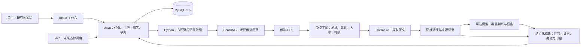

# InfoExplorer：项目目标与交付范围

更新：2026-10-15。本文是目标与产品约定；实现和验证状态以 CURRENT_STATE.md 为准。未通过验收的功能不能写成简历中的已完成能力。

## 1. 产品要解决什么

帮助用户围绕公开主题完成一次有证据的研究，并持续了解该主题之后发生的变化。核心体验不是多一个聊天窗口，而是能回答：查了什么、看了哪些资料、结论依据是什么、哪些尚未确定、相比上一次新增了什么。

主要使用者是需要了解技术、产品或公开事件的个人研究者。首版使用公开资料，不处理私人文档、账号内页面或内部业务数据。当前没有身份系统，只适合本机使用。

目标用户路径：

1. 输入问题和时间/语言偏好，创建研究任务。
2. 查看执行状态，完成后阅读报告与证据；资料不足时看到真实的缺口。
3. 选择值得继续关注的主题，建立追踪，并明确执行频率和预算。
4. 在下一轮完成后查看新增资料、已有事实的补充或修正及时间线。
5. 回看任一轮次的证据与执行记录，避免只有一段无法溯源的回答。

## 2. 三个交付层次

| 层次 | 交付内容 | 完成边界 |
|---|---|---|
| A：可解释的网页研究 | 通用网页搜索、正文提取、证据筛选、有界补搜、引用与部分失败展示 | 可以在公开页面真实联调；不代表全网覆盖或事实自动核验 |
| B：持续事件追踪 | 追踪主题、手动刷新、有限定时刷新、跨轮去重、来源修订、时间线 | 能解释何时发现、何时发生、依据何在；搜索没找到不等于无事件 |
| C：可复现的工程交付 | 可重复部署、配置检查、迁移/备份流程、测试证据、故障诊断和演示说明 | 干净环境可按文档运行；无密钥入库；不以虚构并发或性能数字包装 |

优先完成 A 的可靠链路，再完成 B 的手动追踪，最后开启调度并完善 C。部署与安全基础随每阶段推进，不集中留到最后。

## 3. 明确不做的首版范围

- 不自建全网搜索索引，不爬取整个网站，不绕过登录、验证码或付费墙。
- 不为展示技术而同时接入多个消息队列、向量库、缓存和 Agent 框架。
- 不宣称替代搜索引擎、不承诺答案一定正确、不把多个转载域名当作多个独立证据。
- 不把所有研究问题都做成长期订阅；一次研究与持续追踪有不同数据模型。
- 不支持多用户公网使用，直到身份、授权、隔离、配额和部署边界完成。
- 不把模型自报的置信度或相似度当成真实性评分。

## 4. 关键产品规则

**研究任务**：一次用户意图；失败重试产生新执行，历史不覆盖。修改问题或范围创建新任务，不改写已有证据。

**执行完成**：程序运行到终点。**资料充分**：当前证据是否覆盖问题。两者分别显示；不得仅用绿色“完成”暗示问题已经得到可靠回答。

**证据**：本次实际获取且保存的正文段落，带来源、获取时间和哈希。搜索摘要、模型记忆、供应商生成的答案不自动算作正文证据。

**事件**：来源描述的一个变化或发生事项。发布时间、发现时间、事件时间不同；不确定的日期明确标记，不编造精确时刻。

**修正**：新资料可能推翻或限定旧说法。保留旧版本及新证据，不静默覆盖历史，不声称模型能自动裁定所有矛盾。

## 5. 技术路线与职责

| 部分 | 保留/选择 | 业务职责 |
|---|---|---|
| Web 前端 | React、TypeScript、Vite、TanStack Query、Ant Design | 创建、阅读、证据定位、追踪时间线和状态反馈 |
| 业务后端 | Java 21、Spring Boot、Spring JDBC、Flyway | API、任务状态、幂等、调度、事务持久化和权限边界 |
| 研究服务 | Python、FastAPI | 规划、搜索/正文适配、筛选、补搜、报告 |
| 数据 | 本机 MySQL；保留 H2 的开发/测试路径 | 任务、执行、来源、证据、追踪及修订关系 |
| 搜索 | 自部署 SearXNG | 发现多个网站的候选 URL；上游能力需验证 |
| 正文 | 受控下载器 + Trafilatura | 安全获取静态 HTML、提取正文与元数据 |
| 模型 | 可替换供应商、默认关闭 | 规划、覆盖判断、证据驱动报告；无系统操作工具权限 |

Crawl4AI、向量检索、Redis、消息队列、多实例部署是后续条件性选择。只有遇到明确限制并有验证方案时才引入。

下面是目标架构，不表示所有连线已经接通。2026-10-22 已接通 React → Java/MySQL → Python → SearXNG/网页正文与可选模型，并实现资料追踪与有界调度。实际验收、报告质量限制与未完成事件语义能力仍以 CURRENT_STATE 为准。

模型建议的补搜仍回到同一 Python 流程，最多一轮，并消耗同一个预算。数据库由 Java 写入；模型不能绕过流程直接访问网页、数据库或本机工具。前端负责展示实际结果，不自行补造缺失证据。

## 6. 简历与面试的可验证内容

当前可谈的是已验证的幂等、事务持久化、失败重试、跨语言 HTTP 契约、MySQL/H2 迁移、前端查询状态和模型输出校验。历史验证明细在 CURRENT_STATE.md；面试演示应可现场重现。

后续重点可以围绕四个具体问题展开：

- 同一任务重复提交或服务重启，如何防止重复执行和历史丢失？
- 搜索结果不相关、网页无法打开、模型输出不合法，系统如何降级并保留证据？
- 追踪主题重复调度、错过时间点、来源更正，如何处理幂等和时间线版本？
- 外部 URL 和网页指令不可信，如何阻止内网访问与越权调用？

衡量指标只在真实测量后填写：各阶段耗时、请求数、有效正文比例、失败类别、数据库查询计划和资源占用。不要提前写“高并发”“准确率提升 X%”或“生产级”。用户已明确不建立固定问题评测集、不做旧新答案对照，本计划不以此作为前置条件。

## 7. 文档入口与协作

- [当前事实与验证](CURRENT_STATE.md)：本次完成、未完成和阻碍。
- [实施清单](TASKS.md)：按依赖推进的工作包与完成标准。
- [网页研究](architecture/WEB_RESEARCH.md)：检索、证据、预算与接口方向。
- [事件追踪](architecture/EVENT_TRACKING.md)：主题、轮次、时间线与调度设计。
- [工程交付](architecture/DELIVERY.md)：运行、测试、故障和发布边界。
- [后端](architecture/BACKEND.md)、[前端](architecture/FRONTEND.md)：当前实现与扩展点。

每次交接记录目标、修改范围、测试结果、剩余阻碍；把聊天中的决定写进相关设计，不复制整段聊天。设计修改可连续执行；凭据交互、日常库升级和系统重启独立处理。Git 操作仍等待用户另行授权。
